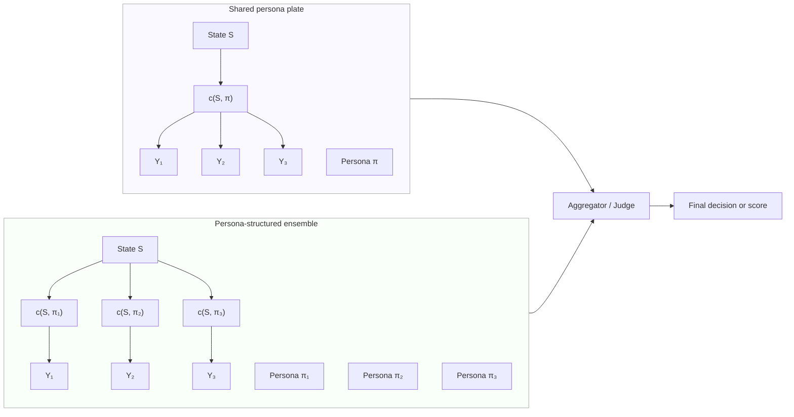

# Probabilistic Language Programming: Theoretical Foundations and Design Principles

## Abstract

Large language models (LLMs) are now the dominant substrate for building AI systems and “agents,” yet most current practice is based on ad hoc scripts, hand-tuned prompts, and loosely specified orchestration frameworks. This document develops a probabilistic, text-native view of these systems in which prompts, completions, and agentic workflows are treated as a unified probabilistic program over execution traces. We introduce **Probabilistic Language Programming (PLP)**: a small set of composable primitives and semantic conventions that make LLM-centric systems look and behave like probabilistic programs in the sense of classical probabilistic programming languages (PPLs), but with language models as the only stochastic kernels. We formalize LLM calls as random variables, define traces and states, and show how PLP interprets prompt engineering as model design and agentic orchestration as approximate inference over distributions on traces. We then develop a quantitative reliability layer—based on ensembles, sequential tests, decomposition, and calibration—that makes explicit the assumptions under which error probabilities can be bounded. The presentation mirrors the algorithmic style of *Introduction to Algorithms* (Cormen, Leiserson, Rivest, Stein) while adopting a probabilistic perspective inspired by Murphy’s *Machine Learning: A Probabilistic Perspective*.

## 1. Introduction and Motivation

The current LLM ecosystem is rich in tools but poor in unifying theory. Practitioners build complex systems by chaining together prompts, tools, vector stores, and external APIs, often under labels such as “agentic workflows,” “reasoning frameworks,” or “orchestration engines.” Each framework introduces its own vocabulary and abstractions, making it hard to compare designs, to reason about failure modes, or to transfer insights from one system to another.

In parallel, the probabilistic programming community has developed a mature mathematical and software ecosystem for describing uncertain computations: random variables, generative models, conditioning, and inference algorithms. Languages such as Stan, PyMC, Pyro, and NumPyro let users define models using primitives like `sample`, `observe`, `factor`, and `plate`, and then choose inference strategies to approximate posterior distributions.

The central thesis of PLP is that **LLM-based systems can and should be viewed as probabilistic programs**:

- An “agent” is not a monolithic worker but a **distribution over behaviors** induced by a language model and a prompt.
- A “prompt” is not just a string but a **parameterization of a stochastic kernel**.
- A “tool call” or “function invocation” is a **deterministic transition** in a larger state space.
- A complex agentic workflow is a **composite generative process** with latent variables (plans, intermediate thoughts, hidden rationales) and observations (tests passed, judges’ verdicts, user constraints).

PLP provides a small set of primitives and a runtime that make these ideas explicit while remaining close to how people actually build LLM pipelines. The aim of this document is not to describe implementation details, but to articulate the **semantic core** of PLP as a probabilistic programming system and to show how it unifies:

- Prompt and context engineering.
- Classical probabilistic programming ideas.
- Modern agentic and orchestration architectures (self-consistency, chain-of-thought, Tree-of-Thoughts, debate, tool-using agents, multi-agent systems).

We proceed in increasing order of abstraction: from random variables and LLM calls, to traces and states, to primitives, to agentic patterns, to reliability guarantees and calibration.

## 2. From Probabilistic Programming to Probabilistic Language Programming

Probabilistic programming starts from a simple idea: instead of fixing a single deterministic algorithm, we describe a **generative story** for how data could have been produced. This story is a program with random choices. In Murphy’s notation, we might write
$$
  p(x, z) = p(z)\,p(x | z),
$$
where $z$ are latent variables and $x$ are observed variables. A probabilistic program operationalizes this as a sequence of `sample` and `observe` statements interleaved with deterministic computation.

PLP adopts the same conceptual structure, but changes the basic domains and the kinds of stochastic primitives that are available:

- The primary random variables range over **strings**, or more generally over structured objects whose natural representation is textual.
- The only primitive distributions available are those **induced by language models**. For a fixed LLM with parameters $\theta$, a prompt $c$ defines a conditional distribution
  $$
    Y \sim P_\theta(\,\cdot | c),
  $$
  where $Y$ is a string-valued random variable.
- Deterministic computation is ordinary host-language code (Python), updating a structured state that may contain text, numbers, and other data.

Even with this constrained set of ingredients, we can recover the usual PPL abstractions at the level of semantics:

- **Random variables** become **text sites** where an LLM is called.
- **Priors** become **unconstrained prompts**.
- **Likelihoods** become **judges and verifiers**, often implemented as additional LLM calls or external checks.
- **Posteriors** become **distributions over traces and final states**, implicitly represented by ensembles of executions and their scores.
- **Inference algorithms** become **agentic orchestration patterns**: ensembles, debate, self-refinement, heuristic search.

The PLP library implements this view for Python, providing:

- A notion of **program state** that carries both conventional variables and a trace of stochastic events.
- A collection of **primitives** (`sample`, `observe`, `factor`, `guarantee`, and text-native variants) that are the only way to introduce or score randomness in a PLP program.
- Combinators such as **plates**, **handlers**, **guides**, and **agents** that mirror constructs in modern PPLs while remaining grounded in language.

In the remainder of this document, we develop the mathematical picture that underlies these components.

## 3. LLM Calls as Random Variables

### 3.1 Conditional language models as stochastic kernels

Fix a vocabulary $\Sigma$ and let $\Sigma^*$ denote the set of all finite strings over $\Sigma$. A large language model (LLM) with parameters $\theta$ defines a family of conditional distributions
$$
  P_\theta(\,\cdot | c) \quad \text{over } \Sigma^*,
$$
indexed by **contexts** or **prompts** $c \in \mathcal{C}$. In practice, a context is a concatenation of system messages, user messages, and possibly previous turns; for the purpose of semantics, we need only that each context $c$ determines a measure on strings.

We treat each LLM call as sampling a string-valued random variable
$$
  Y_i \sim P_\theta(\,\cdot | C_i),
$$
where $C_i$ is the (random) context at call site $i$. The context $C_i$ is itself a deterministic function of a program state $S_i$, which encodes the entire history of previous random draws and deterministic updates.

Thus each call corresponds to a **stochastic kernel**
$$
  K_i(S_i, A) = \Pr\!\bigl[\, h_i(S_i, Y_i) \in A \,\bigm|\, Y_i \sim P_\theta(\,\cdot | g_i(S_i)) \,\bigr],
$$
where:

- $g_i$ builds the prompt from the current state ($C_i = g_i(S_i)$),
- $Y_i$ is the LLM output,
- $h_i$ postprocesses the output and updates the state ($S_{i+1} = h_i(S_i, Y_i)$),
- $A$ ranges over subsets of the state space.

This makes an LLM call **semantically equivalent to a `sample` statement** in a PPL: given the current state, we draw from a (possibly highly complex) distribution and obtain a new state.

Both **stochastic decoding** (non-zero temperature, nucleus sampling, etc.) and **deterministic decoding** (greedy or beam search) fit into this picture. In the deterministic case, $P_\theta(\cdot \mid c)$ is a **Dirac measure** concentrated on a single string $y^\star(c)$, so $Y_i$ is almost surely equal to $y^\star(c)$ and the corresponding kernel $K_i$ is a deterministic transition. The measure-theoretic semantics and the definition of $p(\tau)$ remain valid for such singular distributions; however, many of PLP’s *probabilistic* error bounds (Section 8) are most informative when there is residual randomness across traces—either from stochastic decoding, from randomness in task selection, or from additional noisy primitives such as judges.

### 3.2 Execution traces

An execution of a PLP program produces a **trace**
$$
\tau = (S_0, E_1, S_1, E_2, S_2, \dotsc, E_T, S_T),
$$
where:

- $S_0$ is the initial state determined by the caller (for example, containing the user task),
- each event $E_i$ records the details of the $i$-th stochastic or scoring primitive (which primitive, which prompt, which output, which metadata),
- each $S_i$ is the resulting program state after the $i$-th event.

Under mild conditions on the primitives, this trace is a realization of a Markov chain with state space equal to the program state space. Let $\mathcal{I}_{\text{sample}}$ denote the indices of sampling sites and $\mathcal{I}_{\text{score}}$ the indices of scoring or observation sites. For a fixed trace $\tau$ we write:
$$
  w(\tau)
  \;=\;
  \prod_{i \in \mathcal{I}_{\text{sample}}}
    P_\theta\!\bigl(y_i | c_i\bigr)
  \;\cdot\;
  \prod_{j \in \mathcal{I}_{\text{score}}}
    \phi_j(\tau),
$$
where $y_i$ is the sampled output at site $i$, $c_i$ is the corresponding context, and each $\phi_j(\tau) \ge 0$ is a (possibly heuristic) **factor** attached by a scoring or observation primitive. In many cases $\phi_j$ depends only on *local* quantities at site $j$ (for example, a judge applied to a single $(x,y)$ pair), mirroring local clique potentials in graphical models. PLP also permits **global factors** whose value depends on a larger portion of the trace—for example, a verifier that inspects an entire sequence of intermediate steps or a collection of test-case outcomes. Mathematically, all such factors are simply non-negative measurable functions of $\tau$, but distinguishing “local” from “global” is useful when reasoning about structure and independence.

The **probability measure over traces** is then
$$
  p(\tau) \;=\; \frac{w(\tau)}{Z},
  \qquad
  Z \;=\; \sum_{\tau} w(\tau),
$$
with $Z$ the normalizing constant (typically intractable but not needed for many inference tasks).

In contrast to traditional PPLs, PLP does not assume that we can evaluate the exact probability density of each random draw. The language model is treated as a **sampling oracle** rather than a source of log-probabilities. This shifts emphasis from analytic densities to:

- sampling procedures,
- qualitative judgments (e.g., “answer A is better than answer B”),
- and discrete decisions based on comparisons.

Nevertheless, the underlying mathematical object—a probability measure over traces—remains the same.

From a **model-selection** standpoint, the normalizing constant $Z$ plays the usual role of **model evidence**: different PLP programs (different prompts, agent decompositions, or judge configurations) induce different weight functions $w(\tau)$ and hence different $Z$’s. In classical PPLs, ratios of evidences $Z_1/Z_2$ support Bayes factors and principled model comparison. In PLP, two practical complications arise:

- many LLM APIs do not expose reliable log-probabilities, so the $P_\theta(y_i \mid c_i)$ factors are often treated as *implicit* while only the $\phi_j(\tau)$ factors are explicitly tracked; and
- in many applications, users care more about **downstream task loss and cost** than about literal marginal likelihoods.

As a result, PLP’s current design emphasizes **decision-theoretic comparison** of architectures—measuring calibrated success rates, costs, and error bounds under a shared task distribution—rather than explicit estimation of $Z$. In principle, one could import techniques such as bridge sampling or annealed importance sampling over trace space to approximate evidence ratios between PLP programs, using common proposal distributions defined by guides or ensembles. We view this as an important direction for future work rather than a solved component of the present framework.

### 3.3 Example: chain-of-thought as a probabilistic program

Consider a familiar chain-of-thought (CoT) pattern:

1. Given a problem description $x$, the model first generates a reasoning trace $r$.
2. Conditioning on $x$ and $r$, it then generates a final answer $y$.

In PLP notation, this is naturally described as:
$$
  r \sim P_\theta(\,\cdot | c_{\text{reason}}(x)), \qquad
  y \sim P_\theta(\,\cdot | c_{\text{answer}}(x, r)),
$$
with a deterministic postprocessor that parses $y$ into a structured output. The pair $(r, y)$ is a random variable with a joint distribution defined by the composition of two kernels.

If we further add a judge that assesses correctness,
$$
  J \sim P_{\theta'}(\,\cdot | c_{\text{judge}}(x, y)),
$$
we can treat the judge’s verdict as an **observation**: traces where $J$ says “incorrect” receive low or zero weight. This is exactly the structure $p(r, y, j | x)$ familiar from probabilistic modeling, now instantiated entirely through LLM calls.

## 4. State, Traces, and the Semantic Core of PLP

### 4.1 Program state as a language-enriched store

PLP programs manipulate an explicit **state object** $S$ that contains:

- named variables holding strings, numbers, or structured data;
- a log-weight $\log w(S)$, representing the cumulative score of the trace so far;
- a trace log, recording each primitive invocation and its metadata.

Deterministic computations—parsing, arithmetic, database queries, tool calls—are pure functions $S \mapsto S'$. Stochastic computations are realized only through **primitives** that interact with LLMs or modify the log-weight.

This separation is modelled on standard PPL practice:

- random primitives contribute to the measure over traces;
- deterministic code contributes only to the mapping from random draws to outputs.

### 4.2 Events and trace semantics

Each application of a primitive produces a **trace event** $E_i$ with fields such as:

- a site name (identifying the location in the code),
- the kind of primitive (sample, observe, score, guarantee, transition, etc.),
- the prompt and output text (for text-based primitives),
- numerical metadata (scores, lengths, auxiliary annotations).

The semantics of the program can be understood in two complementary ways:

1. **Operational view**: starting from $S_0$, repeatedly apply deterministic and stochastic transitions according to the program, collecting events until a termination condition is met. The result is a concrete trace and a final state.
2. **Denotational view**: associate to each complete trace $\tau$ a weight $w(\tau)$ as above and consider the normalized measure $p(\tau) = w(\tau)/Z$ over traces. Aggregate quantities (such as the distribution over final answers) are expectations with respect to this measure.

The library’s runtime implements the operational view directly, but its design—logging events, tracking log-weights, supporting handlers—makes the denotational view explicit and manipulable.

### 4.3 What is a trace? Mathematical and practical views

It is useful to be precise about what a “trace” is, both mathematically and in concrete PLP code.

**Mathematical view.**  
Fix a PLP program and an initial state distribution over $S_0$. Let $(\Omega, \mathcal{F}, \mathbb{P})$ be an abstract probability space capturing all randomness in the program (LLM draws, external randomness, etc.). Each execution of the program corresponds to a sequence of states and events
$$
  \tau = (S_0, E_1, S_1, \dots, E_T, S_T)
$$
for some finite $T \ge 0$. Let $\mathcal{T}$ denote the set of all such finite sequences that the program can produce. Then a **trace random variable** is a measurable map
$$
  \mathbf{T} : \Omega \to \mathcal{T},
$$
which sends each outcome $\omega \in \Omega$ (one possible realization of all randomness) to the corresponding execution trace $\tau = \mathbf{T}(\omega)$. The distribution $p(\tau)$ defined in Section 3.2 is exactly the **pushforward measure** of $\mathbb{P}$ under this map:
$$
  p(\tau) = \mathbb{P}\bigl(\mathbf{T} = \tau\bigr).
$$
Any random quantity produced by the program—final answers, intermediate summaries, costs—can be viewed as a function of the trace, $F = f(\mathbf{T})$, so that
$$
  \mathbb{E}[F] = \sum_{\tau \in \mathcal{T}} f(\tau)\,p(\tau).
$$
From this perspective, PLP is a language for defining the trace space $\mathcal{T}$ and the distribution $p$ on it; inference procedures operate by sampling or transforming $\mathbf{T}$.

**Practical view.**  
In the implementation, a trace is represented concretely as the `trace` field of a `PLPState` object: an ordered list of `TraceEvent` records, one for each primitive invocation. Each `TraceEvent` stores, among other things:

- which primitive was invoked (e.g., `sample`, `text_sample`, `text_score`, `guarantee`);
- the prompt and output (for text-based primitives);
- numerical metadata such as log-scores, lengths, or domain tags.

The sequence of `TraceEvent` objects, together with the initial state and the deterministic updates between events, **is** the concrete realization of $\tau$ in code. Handlers, guides, and inference engines in PLP operate by inspecting and transforming these traces—for example:

- replaying a trace with some sites blocked or modified;
- conditioning on parts of a trace (fixing certain events and resampling others);
- summarizing a long trace into a shorter representation used by later prompts.

Thus, mathematically, a trace is an element of a probability space; practically, it is a structured execution log that PLP exposes as a first-class object for inspection, debugging, and probabilistic manipulation.

## 5. Core Primitives: A Basis for Language-Native Modeling

PLP’s semantic core consists of a small set of primitives that play the same roles as `sample`, `observe`, and `factor` in classical PPLs, specialized to language.

### 5.1 Sampling primitives

The fundamental operation is a **sample** from an LLM-induced distribution:
$$
  y \sim P_\theta(\,\cdot | c),
$$
where $c$ is a context derived from the current state. In PLP, this appears in two layers:

- A **generic primitive** for sampling arbitrary (possibly structured) values from an LLM, with prompt construction and parsing handled by user code.
- A **text-first primitive** for sampling raw strings, which directly records the prompt and output.

In both cases, the semantics is that the program state is updated with a new random value, and a corresponding event is appended to the trace.

### 5.2 Scoring and observation primitives

Classical PPLs distinguish between:

- `observe`: conditioning on observed data by multiplying the trace weight by a likelihood term.
- `factor` or `score`: multiplying the trace weight by an arbitrary user-specified term.

PLP mirrors this with:

- **textual observation primitives**, which take a Boolean or categorical judgment (e.g., pass/fail, bucketed confidence) and update the trace’s log-weight accordingly;
- **score primitives**, which directly add a log-score $\log s$ to the trace.

These scores can be derived from:

- external, symbolic checks (e.g., unit tests, parsers, theorem provers),
- additional LLM calls playing the role of verifiers or judges,
- structural heuristics (e.g., length penalties, redundancy penalties).

Importantly, the library does not require that these scores correspond to true log-likelihoods under a fully specified generative model. Instead, it treats them as **surrogate factors**: higher scores indicate more plausible or more desirable traces under some evaluation criterion (task loss, safety policy, style guide, etc.). This allows practitioners to bring practical heuristics into a probabilistic framework without overclaiming about exact Bayesian optimality, while still retaining a clear separation between **modeling choices** (which factors are attached) and **inference choices** (how traces are sampled and reweighted given those factors).

### 5.3 Guarantees and hard constraints

In many applications, certain properties must hold **with extremely high probability**: outputs must satisfy a schema; code must compile; safety constraints must never be violated. PLP surfaces this requirement through **guarantee primitives**.

Conceptually, a guarantee enforces
$$
  \Pr[\text{property fails}] \leq \delta,
$$
for a user-specified $\delta$. Operationally, a guarantee primitive:

1. Attempts to steer generation via constrained prompting.
2. If the constraint is violated, invokes repair steps (editing, reiterating with refined instructions, fallback strategies).
3. Marks the trace as invalid (zero weight) if all repair attempts fail.

The key idea is that **guarantees are part of the program’s specification**, not just runtime checks. They can be composed and reasoned about using probabilistic tools (union bounds, decomposition of error budgets) as described in Section 8.

### 5.4 Plate notation and replicated structure

Classical probabilistic programming languages use **plate notation** to express independent replication: drawing many conditionally independent samples that share the same parents. In graphical-model terms, a plate over an index set $\mathcal{I}$ around a random variable $Y$ indicates that we have a family $\{Y_i : i \in \mathcal{I}\}$ with factorization
$$
  p(y_{\mathcal{I}} | \text{parents})
  = \prod_{i \in \mathcal{I}} p(y_i | \text{parents}).
$$

In PLP, plate structure appears whenever we repeat a block of code for multiple independent instances: ensembles of candidate answers, batched evaluation over a dataset, or parallel subtasks in a decomposition. The `plate` and `plate_map` combinators in the library make this structure explicit.

**Mathematical view.**  
Suppose a PLP program has a subroutine that, given state $S$, samples a text-valued variable
$$
  Y \sim P_\theta(\,\cdot | c(S)).
$$
Wrapping this subroutine in a plate of size $N$ yields variables $Y_1,\dots,Y_N$ with joint conditional distribution
$$
  p(y_{1:N} | S)
  = \prod_{n=1}^N P_\theta\bigl(y_n | c(S)\bigr),
$$
and a corresponding collection of trace events $\{E_{i,n}\}$, one for each replica. In terms of the trace weight,
$$
  w(\tau)
  \propto
  \prod_{n=1}^N P_\theta\bigl(y_n | c(S)\bigr)
  \times \text{(other factors)}.
$$
This factorization is what underlies ensemble error bounds and Monte Carlo estimates: expectations with respect to a single-site distribution can be approximated by averages over plate replicas, and independence allows concentration inequalities to apply.

Often, the context $c(S)$ itself depends on a **persona** or role parameter $\pi$ (for example, “you are a math tutor,” “you are a code reviewer”). In that case we write
$$
  Y \sim P_\theta(\,\cdot | c(S, \pi)),
$$
and distinguish two common plate patterns:

- **Shared persona across replicas.**  
  Here $\pi$ is fixed and the plate replicates only internal LLM randomness:
  $$
    p(y_{1:N} | S, \pi)
    = \prod_{n=1}^N P_\theta\bigl(y_n | c(S,\pi)\bigr).
  $$
  This corresponds to a single persona with multiple stochastic draws; error analysis proceeds exactly as in basic self-consistency.

- **Persona-structured ensemble.**  
  Here we index personas by $k \in \{1,\dots,K\}$ and let
  $$
    Y_k \sim P_\theta(\,\cdot | c(S, \pi_k)).
  $$
  The joint distribution conditional on $S$ and the persona set $\{\pi_k\}$ is
  $$
    p(y_{1:K} | S, \pi_{1:K})
    = \prod_{k=1}^K P_\theta\bigl(y_k | c(S,\pi_k)\bigr).
  $$
  This is a **mixture-of-personas ensemble**: each replica lives under a different conditional distribution $q_k(y | S) = P_\theta(y | c(S,\pi_k))$. If personas are chosen from a prior $p(\pi)$ or are learned, the marginal becomes a mixture
  $$
    q_{\text{mix}}(y | S)
    = \sum_k w_k\,q_k(y | S),
  $$
  with weights $w_k$ determined by how often each persona is used.

This framing clarifies what to expect from personas:

- Personas that merely rephrase the same behavior (highly overlapping $q_k$) add little beyond extra samples from a single proposal.
- Carefully differentiated personas (for example, one optimized for precision, another for recall, another for safety) implement a structured mixture proposal that can improve coverage of the true target $p^*(y | S)$ and reduce correlation between replicas.
- Each persona $k$ has its own calibrated reliability parameters (such as $p_{\text{solve}}^{(k)}$, $p_{\text{judge}}^{(k)}$), which can be estimated and combined within PLP’s reliability framework; this makes it possible to reason formally about when persona diversity is beneficial and how to weight or select personas in ensemble inference.

From a probabilistic perspective, **engineering personas** becomes an optimization problem over the family $\{q_k\}$: we want each $q_k$ to have high expected quality (low loss under verifiers) while the family as a whole spans a diverse set of modes of $p^*$. One natural way to express this is via an objective of the form
$$
  \mathcal{J}(\{\pi_k\})
  =
  \underbrace{\sum_{k=1}^K \mathbb{E}_{Y \sim q_k(\cdot | S)}
    \bigl[L(Y; S)\bigr]}_{\text{average loss under each persona}}
  \;-\;
  \lambda\,
  \underbrace{\mathrm{Div}\bigl(\{q_k(\cdot | S)\}_{k=1}^K\bigr)}_{\text{diversity term}},
$$
where $L$ is a task loss derived from verifiers and $\mathrm{Div}$ is a diversity functional, such as an average pairwise divergence
$$
  \mathrm{Div}(\{q_k\})
  =
  \frac{1}{K(K-1)}\sum_{k \ne \ell}
    D\bigl(q_k(\cdot | S) \,\|\, q_\ell(\cdot | S)\bigr)
$$
for some symmetric divergence $D$ (for example, Jensen–Shannon). We cannot evaluate these divergences in closed form, but we can approximate them empirically by sampling from each $q_k$ and measuring pairwise **disagreement rates** or differences under judges.

This objective is closely related in spirit to **particle-based variational methods** such as Stein Variational Gradient Descent (SVGD), in which a set of particles is simultaneously attracted toward high-probability regions and repelled from one another by a kernel-based diversity term. In PLP, personas play the role of particles and the diversity functional encourages them to occupy distinct modes of a task-induced objective. However, unlike SVGD, PLP operates in a discrete text space without access to $\nabla \log p$, so the connection is conceptual rather than a direct application of Stein operators; making this link fully rigorous would require additional structure (for example, continuous embeddings with differentiable update rules), which we leave for future work.

Textual gradients then provide a way to **optimize $\{\pi_k\}$ programmatically, in a heuristic sense**. Here “gradient” is explicitly metaphorical: PLP does not compute derivatives of a known objective with respect to continuous parameters, but instead uses the LLM to propose **local edits in text space** that are predicted to improve an empirically estimated loss. For each persona $k$ we can define an empirical surrogate of the per-persona objective
$$
  \hat{\ell}_k(\pi_k)
  \approx
  \mathbb{E}_{Y \sim q_k}
    \bigl[L(Y; S)\bigr]
  \;-\;
  \lambda\,\widehat{\mathrm{div}}_k,
$$
where $\widehat{\mathrm{div}}_k$ measures how different $q_k$’s samples are from those of other personas (for example, via judge-based disagreement or embedding distance). Given the current persona description (its prompt text) and a natural-language description of this surrogate loss—for instance,

> “You are persona $k$. Your current samples tend to agree too often with personas 1 and 2 while still making occasional factual mistakes. Modify your role description to maintain or improve factual correctness while increasing diversity of reasoning style and answers relative to the other personas.”

we can invoke `textgrad_step` on the persona text itself. Iterating this process across personas defines a **stochastic local search in persona space**, with the LLM acting as a heuristic proposal mechanism that suggests small edits to persona descriptions that tend (empirically) to reduce $\hat{\ell}_k$. Unlike true gradient-based methods, there are no general convergence guarantees; instead, this is best viewed as a form of derivative-free, hill-climbing-style optimization over discrete prompt texts.

The accompanying demo script at `examples/textgrad_svgd.py` makes this concrete: it spins up a configurable set of persona particles (mathematician, statistician, engineer, etc.), asks the LLM to judge textual overlap, and then repeatedly applies `textgrad_step` to each persona prompt so that the ensemble continuously trades off coverage against redundancy—mirroring the SVGD intuition for attraction/repulsion described earlier.

In this way, persona prompts are no longer static labels but **learnable parameters** of a plate-structured proposal family. PLP’s trace semantics, together with textual gradients and calibration, provides the feedback signals needed to adjust these parameters toward ensembles that are simultaneously accurate, diverse, and analytically tractable.

**Textual and implementation view.**  
In the textual setting, plate notation covers patterns such as:

- drawing $K$ independent candidate answers for the same question (self-consistency);
- running the same micro-agent on many subtasks in parallel;
- evaluating a candidate program on many test cases.

Concretely, PLP’s `plate` machinery:

- tags each `TraceEvent` with plate indices so that replicas can be grouped and analyzed together;
- ensures that, conditional on shared parents in the state, each replica’s random draws are independent as stochastic samples from $P_\theta(\cdot \mid c(S))$ (even though downstream properties of those draws—such as correctness indicators—may still be positively correlated due to shared inductive biases);
- enables vectorized or batched execution of LLM calls when supported by the underlying client.

From the trace perspective, a plate induces a **product structure** on a subset of events: the portion of $w(\tau)$ associated with that subset factorizes across indices. This is exactly the condition needed to import standard tools—law of large numbers, Chernoff bounds, stochastic variational objectives—into the PLP setting, and it is what makes many agentic patterns (ensembles, dataset-level evaluation, multi-agent replicas) both expressible and analyzable within a single probabilistic program.

## 6. Prompt Engineering as Probabilistic Modeling

Prompt engineering is often presented as a craft: carefully worded instructions, exemplars, and formatting conventions that elicit good behavior from an LLM. PLP reframes this as **model design** in a probabilistic program.

### 6.1 Prompts as parameterized proposal distributions

Consider a task with input $x$ (for example, a question) and an ideal but inaccessible target output distribution $p^*(y | x)$ (for example, the distribution over correct, concise explanations). A given prompt template $p$ induces a conditional distribution
$$
  q_p(y | x) = P_\theta(\,\cdot | c_p(x)),
$$
where $c_p(x)$ is the context produced by plugging $x$ into prompt template $p$.

From the PLP perspective:

- The choice of prompt template $p$ is the choice of a **proposal distribution** $q_p$.
- Different templates correspond to different modeling assumptions: how much context to include, how strongly to enforce format constraints, which rationales to elicit.

When verification or additional constraints are present, we can regard $q_p$ as an unnormalized prior and define an **induced posterior** (in the sense of a formally specified target distribution, not necessarily the true data-generating process) over outputs via a factor $\Phi(y, x)$ that aggregates verifier scores and hard constraints:
$$
  \tilde{p}(y | x)
  \;\propto\;
  q_p(y | x)\,\Phi(y, x),
$$
where $\Phi$ is constructed from the scores and observations attached to traces that end in $y$. In general, this induced posterior is a **surrogate Bayesian model** specified by the practitioner: PLP’s goal is not to recover $p^*(y | x)$ exactly, but to make explicit how choices of prompts and verifiers shape this surrogate posterior and to support inference under that model.

PLP’s primitives make this explicit:

- A `sample` site is tied to a particular prompt template $p$.
- Handlers and higher-order operators can **swap or modify prompts** without changing the surrounding program, akin to changing a prior or likelihood in a probabilistic model.

### 6.2 Observations as evaluation surfaces

In probabilistic modeling, likelihoods encode how likely observed data are under different latent configurations. In PLP, we often do not have an analytic likelihood, but we can define **evaluation surfaces**:

- A verifier prompt that judges whether an output is correct for $x$.
- A suite of tests that the output must pass.
- Pairwise comparison prompts that rank multiple outputs.

Each such surface defines a random variable $Z$ whose value reflects how well an output fits the task. Formally, for a verifier LLM with parameters $\theta'$ we may write
$$
  Z \sim P_{\theta'}(\,\cdot | x, y),
$$
and then define a factor $\phi(y; z)$, for example
$$
  \phi(y; z)
  \;=\;
  \begin{cases}
    0, & z = \text{``fail''} \\
    \exp(\alpha\, s(z)), & z \in \{\text{graded outcomes}\},
  \end{cases}
$$
where $s(z)$ maps verifier outputs to real-valued scores and $\alpha$ tunes their strength. PLP’s `observe` and `factor` primitives attach such $\phi$-values to the trace as scores, turning prompt engineering decisions into explicit probabilistic structure:

- choice of verifier $\Rightarrow$ choice of “likelihood” surrogate,
- choice of scoring rule $\Rightarrow$ choice of how harshly failures are penalized,
- choice of comparison scheme $\Rightarrow$ choice of approximate posterior geometry.

### 6.3 Context windows as explicit state

Traditional agentic frameworks often fight against the context window: as tasks become long, the accumulated conversation exceeds what the model can reliably condition on. PLP’s explicit program state offers a principled alternative:

- Only the **relevant slice of state** is converted into a prompt at each site.
- Long-range information is stored in structured form (for example, as summarized notes, tables, or databases) and reintroduced when needed.
- Summarization and canonicalization themselves become primitives with probabilistic semantics: they are random variables that transform long histories into shorter representations.

This mirrors how classical algorithms manage memory: local variables for the current call, and data structures for long-lived information, all under explicit programmer control.

### 6.4 Inference engineering: designing proposal distributions

The perspective that “a prompt is a proposal distribution” invites a more systematic treatment of **inference engineering**: how to design or adapt prompts so that the induced $q_p(y | x)$ is an effective proposal for the (implicit) target posterior $p^*(y | x)$.

#### 6.4.1 Importance sampling viewpoint

Suppose we have a target distribution $p^*(y | x)$ that is only accessible through an **oracle**—for example, by running expensive verifiers, judges, or external tools—and a prompt-induced proposal $q_p(y | x)$ from which we can sample cheaply. Classical importance sampling writes expectations under $p^*$ as
$$
  \mathbb{E}_{p^*}[f(Y) | X=x]
  =
  \int f(y)\,p^*(y | x)\,dy
  =
  \int f(y)\,w_p(y,x)\,q_p(y | x)\,dy,
$$
where
$$
  w_p(y,x)
  = \frac{p^*(y | x)}{q_p(y | x)}
$$
are importance weights. In the PLP setting, we rarely know $p^*$ or $q_p$ in closed form, but we can approximate
$$
  w_p(y,x) \propto \Phi(y,x),
$$
using verifier-induced factors $\Phi(y,x)$ as surrogates for the likelihood ratio.

It is important to emphasize that in PLP the target $p^*$ is typically the distribution **specified by the modeler**—that is, the joint effect of the base LLM prior and all attached factors—rather than an oracle for the true state of the world. If the verifiers or judges that define $\Phi(y,x)$ are misaligned with ground truth (for example, because they can be reward-hacked or overlook certain kinds of errors), then PLP inference faithfully approximates the *specified* $p^*$, not the idealized notion of correctness one might desire. Making this distinction explicit helps separate questions of **inference quality** (“are we sampling from the right posterior?”) from questions of **model specification** (“does our choice of verifiers encode the right notion of correctness?”).

From this viewpoint, a prompt template $p$ is **good** if:

- its support covers the high-probability region of $p^*$ (few or no “impossible” candidates);
- its induced $q_p(y | x)$ is close enough to $p^*(y | x)$ that the variance of the weights $w_p(y,x)$ is small.

Heuristically, prompts that:

- encode the right task decomposition,
- align format and inductive biases with downstream verifiers,
- and exclude obviously invalid regions of the space

produce proposals with lower-variance importance weights, which directly translates into fewer samples needed for reliable estimates and decisions.

The **support condition** is fundamental. If $q_p(y | x)$ assigns zero (or effectively zero) probability to any region where $p^*(y | x)$ places mass—for example, because the base LLM lacks the necessary knowledge or representational capacity—then no amount of importance weighting, ensembling, or clever aggregation can recover those missing solutions. In such cases, PLP’s role is diagnostic rather than curative: it can reveal that the effective $p_{\text{solve}}$ is near zero, but closing the gap requires changing the underlying model, incorporating external tools or retrieval, or redesigning the proposal family itself.

#### 6.4.2 Variational and amortized inference analogies

In variational inference, one chooses a family of proposal distributions $\{q_\phi\}$ and adjusts parameters $\phi$ to approximate a true posterior $p(z | x)$, often by minimizing $\mathrm{KL}(q_\phi \,\|\, p)$. In PLP, a family of prompt templates
$$
  \{p_\phi\}
$$
plays the same role: each template $p_\phi$ induces a proposal $q_{p_\phi}(y | x)$, and we can think of **prompt tuning** as informal variational inference over $\phi$.

In an idealized setting where we had access to a target $p(y | x)$, we might define a variational objective
$$
  \mathcal{L}(\phi)
  = \mathrm{KL}\bigl(q_{p_\phi}(y | x) \,\|\, p(y | x)\bigr)
  =
  \mathbb{E}_{q_{p_\phi}}\bigl[\log q_{p_\phi}(Y | x) - \log p(Y | x)\bigr],
$$
and perform gradient descent on $\phi$. In PLP, $p$ is implicit and $q_{p_\phi}$ is defined through an LLM, so we cannot compute $\nabla_\phi \mathcal{L}$ analytically. Instead, we introduce **textual gradient heuristics**: directions in the discrete space of prompt texts that are *predicted* (by an LLM or by external verifiers) to reduce a surrogate loss functional. These should be understood as **gradient-inspired local search steps**, not as true mathematical gradients with the usual smoothness or convergence guarantees.

PLP’s `textgrad_step` primitive embodies this idea. Given a current text (such as a prompt template or guide) and a natural-language description of a loss (for example, “penalize answers that are factually wrong and overly verbose”), `textgrad_step` asks an LLM to propose a small edit that seems likely to decrease the loss. Repeated application of such steps defines a Markov chain over prompt texts whose transition kernel is biased toward lower-loss regions. In favorable regimes this behaves like a stochastic hill-climbing procedure that often finds lower-loss prompts, but we do not claim the formal convergence or rate guarantees associated with true gradient descent in continuous variational families.

Two connections to standard practice are useful:

- **Hand-designed templates as variational families.**  
  When practitioners iterate on prompt phrasing, examples, and structure, they are implicitly searching over a discrete and continuous parameter space $\phi$ to reduce the discrepancy between $q_{p_\phi}$ and the unknown target $p^*$. Observable symptoms—such as high judge disagreement, frequent repairs, or low calibrated accuracy—act as noisy gradients on this space.

- **Learned prompts and guides as amortized inference.**  
  PLP’s guide and agent mechanisms allow one to **learn** mappings $x \mapsto$ prompt snippets, summaries, or subplans. This is analogous to amortized inference networks in PPLs, where a neural network predicts variational parameters from data. A guide that, given $x$, chooses which examples or tools to include in the prompt is performing amortized design of $q_{p_\phi}(\cdot | x)$ so as to approximate a desired posterior behavior.

Textual gradients make this optimization story more concrete at an algorithmic level. Suppose we define a task-level loss
$$
  \ell(\phi; x)
  = \mathbb{E}_{Y \sim q_{p_\phi}(\cdot | x)} \bigl[L(x, Y)\bigr],
$$
where $L$ is derived from verifiers, judges, or ground truth. We can implement a **gradient-inspired update** by:

1. Fixing $\phi$ (i.e., a concrete prompt template or guide description).
2. Running PLP programs under $q_{p_\phi}$ to observe typical failure modes and to estimate $\ell(\phi; x)$ on sampled tasks.
3. Describing these failures and the associated loss in natural language.
4. Invoking `textgrad_step` on the prompt text itself (“Current prompt: …; loss description: …”) to obtain a revised prompt $\phi'$ that is *hypothesized* to reduce $\ell$.

Iterating this loop implements a form of **derivative-free, stochastic local search** on $\ell(\phi; x)$ in which the LLM plays the role of a proposal mechanism for edits in text space. From a probabilistic-programming standpoint, this is a stochastic optimization of the proposal family $\{q_{p_\phi}\}$ to better approximate a target behavior encoded by $L$ and the PLP trace semantics, but it should not be confused with exact variational optimization under differentiability assumptions.

Although PLP does not prescribe a specific optimization objective for $\phi$, the probabilistic framing suggests natural ones, such as:

- maximizing calibrated success probability under a cost budget;
- minimizing empirical variance of surrogate importance weights $\Phi(y,x)$ across samples;
- or minimizing a divergence between the empirical distribution of accepted samples and a desired reference.

#### 6.4.3 Practical consequences: why some templates work better

This theory helps rationalize empirical observations about prompt templates:

- **Structure that mirrors downstream checks.**  
  Templates that mirror how verifiers operate (for example, clearly separated fields for “answer,” “reasoning,” and “assumptions”) tend to yield $q_p$ whose mass aligns with regions where $\Phi(y,x)$ is high. This reduces the effective variance of importance weights and improves stability under ensemble methods.

- **Task-specific priors.**  
  Domain-specific instructions (“use only integer arithmetic,” “prefer concise answers,” “never invent citations”) encode prior knowledge into $q_p$. From an importance-sampling perspective, this shrinks the domain over which $w_p(y,x)$ is non-negligible, concentrating samples where verifiers are most discriminative.

- **Example selection as proposal shaping.**  
  Few-shot examples act like **conditioning information** that reshapes $q_p(y | x)$. Choosing examples that are representative of high-density regions under $p^*$ is analogous to choosing variational family members with good coverage; conversely, mismatched examples induce multimodal, high-variance proposals.

- **Inference-aware prompting.**  
  When we know that inference will use, say, pairwise judges with a specific rubric, we can design prompts so that $q_p$ generates candidates that differ primarily along dimensions that the judge is good at discriminating. This increases the effective “signal” in the comparison variables $J_{i,j}$, improving the constants in ensemble and SPRT bounds derived earlier.

In all these cases, inference engineering is not an ad hoc black art but a form of **proposal distribution engineering** guided by probabilistic principles. PLP’s semantics provides the language to make this explicit and, ultimately, to automate parts of the process by closing the loop between empirical calibration, reliability analysis, and prompt/template design.

### 6.5 Modeling additional prompting patterns

Many widely used prompting strategies can also be interpreted within PLP’s probabilistic framework. Rather than treat them as qualitatively new phenomena, we view them as specific ways of structuring proposals, priors, and factors.

#### 6.5.1 Few-shot and in-context examples

Few-shot prompts augment the task input $x$ with labeled examples
$$
  \mathcal{E} = \{(x^{(n)}, y^{(n)})\}_{n=1}^N,
$$
yielding a context $c_p(x, \mathcal{E})$ and proposal
$$
  q_p(y | x, \mathcal{E}) = P_\theta(\,\cdot \mid c_p(x, \mathcal{E})).
$$
From a modeling standpoint, $\mathcal{E}$ can be seen in two complementary ways:

- As **fixed hyperparameters**: the examples are chosen once by the practitioner and treated as part of the prompt template $p$; all randomness is in $Y$.
- As **random context**: the examples are themselves random variables (for example, drawn from a training set or retrieved from a database), in which case the joint model includes a kernel
  $$
    \mathcal{E} \sim R_\phi(\,\cdot \mid x),
  $$
  where $R_\phi$ is a retriever or example-selection mechanism. The effective proposal for $Y$ then integrates over $\mathcal{E}$.

The second view highlights that “in-context learning” is a form of hierarchical modeling: the examples summarize latent structure about the task distribution, and the retriever $R_\phi$ is itself a component that can be calibrated, optimized, or randomized (e.g., by sampling different $\mathcal{E}$ on different runs to reduce correlation between replicas).

#### 6.5.2 Retrieval-augmented prompts

Retrieval-augmented generation (RAG) introduces external documents $D$ that are selected based on the query:
$$
  D \sim R_\phi(\,\cdot \mid x), \qquad
  Y \sim P_\theta(\,\cdot \mid c_p(x, D)).
$$
Here $R_\phi$ is a stochastic kernel from inputs to document sets, and $P_\theta$ conditions on both $x$ and $D$. In PLP:

- the retriever is a (possibly non-LLM) primitive that updates state $S$ by attaching $D$;
- the subsequent LLM call is a `sample` site whose context builder $g(S)$ incorporates $D$;
- downstream verifiers define factors $\Phi(y, x, D)$ that can depend on retrieved content.

This makes explicit that RAG changes the **conditional independence structure** of the model: correctness of $Y$ now depends on both the base LLM and the retriever. Reliability analysis should therefore distinguish $p_{\text{solve}}$ with and without retrieval, and treat retriever failures (irrelevant or adversarial $D$) as separate error events in the decomposition analysis of Section 8.3.

#### 6.5.3 System prompts and roles as hyperparameters

Modern APIs expose **system prompts** or roles (e.g., “you are a careful mathematician”). Formally, these can be modeled as hyperparameters $\psi$ that index a family of kernels
$$
  P_{\theta,\psi}(\,\cdot \mid c),
$$
or equivalently as part of the context-building function $g(S, \psi)$. In PLP:

- fixing $\psi$ defines a particular prior or proposal family;
- adapting $\psi$ across runs (for example, via `textgrad_step` on the system prompt) corresponds to **hyperparameter learning** or hierarchical modeling, where $\psi$ is adjusted to improve task-level loss;
- sampling $\psi$ from a distribution (e.g., a pool of roles or styles) yields mixture proposals analogous to persona ensembles, with the same considerations about coverage and correlation.

Treating system prompts as explicit parameters clarifies how “role engineering” fits into the probabilistic picture: it is prior design over behaviors, not an opaque magic trick.

#### 6.5.4 Tool-calling and function invocation

Many prompting recipes rely on **tool use** or function-calling: the LLM proposes a structured action (such as an API call), an external tool executes it, and the result is fed back into the prompt. In PLP, this takes the schematic form
$$
  A \sim P_\theta(\,\cdot \mid c_{\text{act}}(S)), \qquad
  S' = h_{\text{tool}}(S, A),
$$
where $A$ encodes the tool arguments in text or JSON and $h_{\text{tool}}$ is a (typically deterministic) host-language function that calls the tool and updates the state with its outputs.

Two cases arise:

- If tools are **deterministic given $A$** (e.g., pure database queries), they are simply part of the deterministic transition $S \mapsto S'$ and do not contribute new stochasticity to the trace beyond that already present in $A$.
- If tools are themselves **stochastic or approximate** (e.g., randomized simulation, web search with variable results), they can be modeled as additional random primitives with their own reliability parameters and, if desired, factors reflecting their internal uncertainty.

Either way, PLP treats tool-calling as part of the *state evolution*, while reserving true randomness to explicitly modeled stochastic kernels. This separation makes it easier to assign error budgets: one can attribute failures to (i) bad proposals $A$, (ii) faulty tools, or (iii) mis-specified verifiers, and reason about each component within a unified probabilistic program.

## 7. Agentic Architectures as Inference Strategies

Powerful LLM systems often present themselves as “agents” that plan, reflect, and collaborate. In PLP, such systems are understood as **inference strategies** over an underlying generative story.

### 7.1 Self-consistency and ensemble voting

Self-consistency methods draw multiple independent samples for a task and aggregate them by majority vote or a more sophisticated rule. In PLP, this is a direct application of:

- a **plate** over repeated `sample` sites (independent candidates),
- followed by a **reduction** that selects or reweights candidates based on judges or verifiers.

Let $X$ denote the task description and let $Y_1, \dots, Y_K$ be independent samples from a proposal $q(y | X)$ induced by a prompt:
$$
  Y_k \sim q(\,\cdot | X), \qquad k = 1,\dots,K.
$$
Write $C_k = \mathbf{1}\{Y_k \text{ is semantically correct for } X\}$ and suppose that for the domain in question
$$
  \Pr(C_k = 1 | X) = p > \tfrac{1}{2}.
$$
If we choose the final answer by majority vote,
$$
  Y^{\text{maj}} = \text{mode}\{Y_1,\dots,Y_K\},
$$
then standard Chernoff or Hoeffding bounds imply that the error probability decays exponentially in $K$:
$$
  \Pr\!\bigl(Y^{\text{maj}} \text{ incorrect} | X\bigr)
  \le \exp(-c K),
$$
for some constant $c = c(p) > 0$. When aggregation is performed via a **judge** LLM, we can make a similar statement by introducing pairwise comparison variables. For two candidates $Y_i$ and $Y_j$, let
$$
  J_{i,j} \in \{i,j\}
$$
denote the index the judge declares better, and assume that whenever one candidate is correct and the other incorrect,
$$
  \Pr(J_{i,j} = \text{index of correct candidate}) = q_{\text{judge}} > \tfrac{1}{2}.
$$
Sequential schemes that repeatedly compare candidates and keep a running score approximate a **Sequential Probability Ratio Test (SPRT)** between hypotheses “candidate $i$ is correct” and “candidate $j$ is correct,” with error probabilities controlled by the score thresholds. Section 8 returns to this perspective.

### 7.2 Chain-of-thought, reflection, and text transitions

Chain-of-thought (CoT) reasoning, iterative refinement, and reflection-based methods can all be expressed using **transition primitives**:

- A transition primitive takes a current candidate $y_t$, a loss description $\ell_t$, and produces a refined candidate $y_{t+1}$.
- This is analogous to a Markov chain Monte Carlo (MCMC) step in a continuous space, but here the state space is textual.

In probabilistic terms, a CoT-style model introduces **latent rationales** $R$:
$$
  R \sim P_\theta(\,\cdot | c_{\text{reason}}(X)), \qquad
  Y \sim P_\theta(\,\cdot | c_{\text{answer}}(X, R)).
$$
If $Z$ is a verifier of correctness, the posterior over answers marginalizes over rationales:
$$
  p(Y | X, Z=1)
  \propto
  \sum_{r} P_\theta(r | c_{\text{reason}}(X))\,
          P_\theta(Y | c_{\text{answer}}(X, r))\,
          \phi(Y, r, X),
$$
where $\phi$ encodes the verifier’s score. Iterative reflection and editing then define a Markov kernel on candidate answers. A generic transition primitive has the form
$$
  y_{t+1} \sim Q_\phi(\,\cdot | y_t, \ell_t),
$$
where $Q_\phi$ is a proposal kernel implemented by an LLM. Judges and verifiers can be used to score or accept/reject refinements, yielding analogues of Metropolis–Hastings, annealing, or gradient-based updates in text space.

### 7.3 Tree-of-Thoughts and search over traces

Tree-of-Thoughts and related planning methods grow and prune a search tree of partial solutions. PLP interprets this as:

- a generative model over **partial traces** (each node in the tree is a prefix $\tau_{1:t}$ of an execution),
- coupled with an **inference algorithm** that explores this tree (via breadth-first, depth-first, or heuristic search) while using judges and verifiers to guide expansion and pruning.

Each node expansion corresponds to:

- a sampling step (proposing a next thought or action),
- followed by one or more scoring steps (evaluating promise or correctness),
- possibly followed by branching (multiple continuations) or truncation (abandoning unpromising branches).

The same PLP primitives that encode CoT and self-consistency suffice to express these patterns; the difference lies in how the trace is explored, not in the underlying language.

Formally, if $p(\tau)$ is the generative distribution over complete traces, then any search strategy induces an **approximate posterior** over traces consistent with success constraints $\mathcal{C}$:
$$
  p_{\text{search}}(\tau | \mathcal{C})
  \approx
  \frac{p(\tau)\,\mathbf{1}\{\tau \text{ satisfies } \mathcal{C}\}}{\sum_{\tau'} p(\tau')\,\mathbf{1}\{\tau' \text{ satisfies } \mathcal{C}\}},
$$
with the approximation quality governed by how the search policy allocates expansion budget across partial traces.

### 7.4 Multi-agent systems as modular PLP programs

Multi-agent systems, in which specialized agents communicate and cooperate via language, can be modeled as **modular PLP programs**:

- Each agent is a parameterized PLP subprogram with its own prompts, internal state, and preferred primitives (for example, a Decomposer agent, a Critic agent, a Judge agent).
- The overall system is a higher-level PLP program that orchestrates these subprograms, exchanges messages between them, and applies its own scoring and guarantee logic.

From a probabilistic perspective, such systems implement structured approximate inference:

- Decomposer agents propose factorizations of a task into subtasks (latent discrete structure).
- Solver agents propose candidate solutions to subtasks (local latent variables).
- Aggregator agents combine sub-solutions (deterministic or nearly deterministic mapping).
- Judge and Critic agents provide observations and scores tying everything back to the user’s goal.

PLP’s agent abstractions exist to make this modular structure explicit, but the semantics is still that of a single probabilistic program over a shared state. One convenient way to express this is as a joint distribution. For an input task $X$:
$$
  D \sim P_\theta(D | X),
$$
where $D$ is a random **decomposition plan** generated by a Decomposer agent. The plan $D$ determines subtasks $T_1,\dots,T_m$ and a recomposition map $g$. For each subtask,
$$
  Y_i \sim P_\theta(y_i | T_i, X, D),
$$
and the final solution is
$$
  Y = g(D, Y_{1:m}).
$$
Judges and critics produce observations
$$
  Z \sim P_{\theta'}(z | X, Y, D, Y_{1:m}),
$$
so that the full joint distribution factors as
$$
  p(Y, D, Y_{1:m}, Z | X)
  = p(D | X)\,\prod_{i=1}^m p(Y_i | T_i, X, D)\,
    \delta\!\bigl(Y - g(D, Y_{1:m})\bigr)\,
    p(Z | X, Y, D, Y_{1:m}),
$$
with $\delta$ denoting a point-mass over the deterministic recomposition. This makes clear that a “multi-agent architecture” is simply a structured factorization of a joint distribution over latent plans, sub-solutions, and observations.

### 7.5 Worked example: ensemble question answering with a judge

To make these ideas concrete, consider a simple yet representative pattern: answering a factual question $X$ using an ensemble of LLM samples and a judge.

**Generative story.**

1. A question $X$ is given (we condition on $X$ in what follows).
2. We draw $K$ independent candidate answers from a prompt-induced proposal:
   $$
     Y_k \sim q(\,\cdot | X), \qquad k = 1,\dots,K.
   $$
3. Each $Y_k$ has an (unobserved) correctness label
   $$
     C_k = \mathbf{1}\{Y_k \in \mathcal{Y}^{\text{correct}}(X)\},
   $$
   where $\mathcal{Y}^{\text{correct}}(X)$ is the (unknown) set of correct answers. For the purpose of analysis we adopt a minimal reliability model in which, conditional on $X$ and a fixed prompt or persona, the indicators $C_k$ are independent and identically distributed with
   $$
     \Pr(C_k = 1 | X) = p > \tfrac{1}{2}.
   $$
4. A judge LLM compares pairs of candidates. For each comparison between $i$ and $j$, we draw
   $$
     J_{i,j} \in \{i,j\},
   $$
   with the property that whenever $C_i=1$ and $C_j=0$ (or vice versa),
   $$
     \Pr(J_{i,j} = \text{index of correct candidate} | C_i \ne C_j)
     = q_{\text{judge}} > \tfrac{1}{2}.
   $$
5. An aggregation procedure $f$ (for example, a sequential “first ahead by $k$” rule) selects a final answer index $I^\star$ based on the $J_{i,j}$, and we output $Y^\star = Y_{I^\star}$.

The joint distribution over latent and observed variables conditional on $X$ can be written schematically as
$$
  p(Y_{1:K}, C_{1:K}, J, I^\star | X)
  =
  \bigl[\prod_{k=1}^K q(Y_k | X)\bigr]\,
  \bigl[\prod_{k=1}^K p(C_k | X, Y_k)\bigr]\,
  p(J | C_{1:K})\,
  p(I^\star | J),
$$
where $p(C_k | X, Y_k)$ encodes the (unknown) ground-truth correctness, $p(J | C_{1:K})$ encodes the judge’s behavior, and $p(I^\star | J)$ is concentrated on the deterministic outcome of the aggregation rule.

**PLP realization.**

In PLP terms:

- The $Y_k$ arise from a plate of `sample` sites driven by a shared prompt.
- The $J_{i,j}$ arise from judge `sample` sites whose prompts contain the compared candidates.
- The aggregation rule $f$ is deterministic host-language code operating on the state.
- Optional scoring primitives can attach factors reflecting how confident the judge appears to be in its pairwise decisions.

Under the assumptions $p > 1/2$ and $q_{\text{judge}} > 1/2$, standard concentration and SPRT arguments yield bounds of the form
$$
  \Pr(Y^\star \text{ incorrect} | X)
  \le \varepsilon(K, p, q_{\text{judge}}),
$$
with $\varepsilon$ decaying exponentially in $K$ for majority voting rules and logarithmically in the score threshold for SPRT-style rules. In real LLM systems, support gaps or correlated failures can violate the i.i.d. assumptions behind this bound; Section 8.2 discusses how these effects limit practical error reduction and how PLP exposes the relevant parameters for empirical measurement. The PLP semantics ensures that all of these mechanisms—sampling candidates, querying judges, aggregating evidence—are represented as a single probabilistic program over traces, rather than as an informal orchestration script.

## 8. Reliability via Ensembles, Decomposition, and Sequential Tests

Building reliable systems requires more than a clean semantic story; we need quantitative guarantees about error probabilities. PLP approaches this by combining:

- local models of primitive reliability,
- compositional reasoning about error budgets,
- and algorithmic patterns such as ensembles and Sequential Probability Ratio Tests (SPRT).

### 8.1 Local reliability models

For each primitive and domain, we can define and empirically estimate quantities such as:

- $p_{\text{solve}}$: the probability that a micro-solver primitive returns a correct solution for an atomic task;
- $p_{\text{judge}}$: the probability that a judge primitive correctly prefers a correct candidate over an incorrect one in a pairwise comparison.

These are not properties of PLP alone; they depend on the underlying model, prompts, and domain. PLP’s role is to make these parameters **explicit** so that they can be measured and used in design.

### 8.2 Ensembles and exponential error reduction

To make ensemble reasoning precise, we introduce an explicit **correctness indicator** $C_k = \mathbf{1}\{\text{candidate $k$ is correct}\}$ for each draw $Y_k$. A minimal reliability model assumes that, conditional on the task $X$ and on any fixed prompt or persona,
$$
  C_k \sim \text{Bernoulli}(p), \qquad
  C_1,\dots,C_K \text{ are independent},
$$
for some $p = p_{\text{solve}}(X)$ that is strictly greater than $1/2$ and strictly less than $1$. Under these assumptions, if we sample $K$ independent candidates and choose the final answer by majority vote, standard concentration inequalities imply that the error probability decays exponentially in $K$:
$$
  \Pr[\text{majority is wrong}] \leq \exp(-c K)
$$
for some constant $c$ that depends on $p$. In practice, judges and verifiers introduce additional stochasticity, but similar arguments can be made when the judge has accuracy $p_{\text{judge}} > 1/2$.

These conditions are intentionally idealized. In real LLM systems:

- **Support gaps.** For some tasks, the proposal distribution $q(y | X)$ may assign *negligible or zero* mass to any correct answer (a knowledge gap). In that regime $p_{\text{solve}}(X) \approx 0$, and no amount of ensembling or clever aggregation can recover the ground truth: the failure lies in the model or tools, not in the inference scheme.
- **Correlated failures.** Even when $p_{\text{solve}}(X) > 0$, the correctness indicators $C_k$ are often positively correlated because different samples share training biases and inductive structure. Positive correlation reduces the **effective sample size** of the ensemble and makes the bound $\exp(-c K)$ optimistic; empirically, error may decrease more slowly and plateau at a nonzero floor.

PLP’s semantics isolates where these assumptions enter: independence comes from plate structure (Section 5.4), while $p_{\text{solve}}$ and $p_{\text{judge}}$ are empirical properties of particular prompts, models, and domains. In practice, PLP encourages:

- designing proposals and tools to improve support coverage (for example, through retrieval, external solvers, or diversified personas);
- deliberately **decorrelating replicas** via prompt randomization, persona diversity, or heterogeneous models;
- and treating concentration bounds as *upper envelopes* that must be validated and calibrated against measured correlations, not as guarantees that hold automatically for arbitrary LLM ensembles.

SPRT-style procedures refine this idea by **stopping early** when evidence is decisive:

- Start with an ensemble of candidates.
- Repeatedly compare candidates using a judge primitive.
- Maintain a running evidence score for each candidate.
- Stop and accept a candidate once its score leads all others by a threshold $k$.

Under standard SPRT assumptions for binary hypotheses with success probabilities $p_0$ and $p_1$, the expected number of comparisons needed to achieve type-I and type-II error bounds $(\alpha, \beta)$ satisfies an approximation of the form
$$
  \mathbb{E}[N]
  \approx
  \frac{\log\!\bigl((1-\beta)/\alpha\bigr)}{\mathrm{KL}(p_1 \,\|\, p_0)},
$$
where $\mathrm{KL}$ is the Kullback–Leibler divergence. Heuristic “first-to-ahead-by-$k$” rules in PLP approximate this behavior by using discrete score thresholds instead of explicit likelihood ratios, while retaining the logarithmic dependence on the desired error level.

### 8.3 Recursive decomposition and global error bounds

Now consider a recursively decomposed task, in which a high-level goal is split into subtasks, each solved (possibly by its own recursive decomposition), and finally recomposed. Let $\mathcal{T}$ denote the decomposition tree, with leaf set $\mathcal{L}$ (atomic tasks) and internal node set $\mathcal{I}$ (decomposition steps). For each leaf $\ell \in \mathcal{L}$, define the event
$$
  A_\ell = \{\text{atomic solver for leaf $\ell$ returns an incorrect result}\},
$$
and for each internal node $u \in \mathcal{I}$, define
$$
  B_u = \{\text{decomposition chosen at node $u$ is invalid or unhelpful}\}.
$$
Suppose that for all leaves and internal nodes we can bound
$$
  \Pr(A_\ell) \le \delta_{\text{atom}}, \qquad
  \Pr(B_u) \le \delta_{\text{decomp}}.
$$
Then a simple union bound yields
$$
  \Pr[\text{any local failure}]
  \;=\;
  \Pr\Bigl(\bigcup_{\ell \in \mathcal{L}} A_\ell \,\cup\, \bigcup_{u \in \mathcal{I}} B_u \Bigr)
  \;\le\;
  |\mathcal{L}|\,\delta_{\text{atom}} + |\mathcal{I}|\,\delta_{\text{decomp}}.
$$
If the tree has branching factor at most $B$ and depth at most $D$, then $|\mathcal{L}|$ and $|\mathcal{I}|$ are $O(B^D)$, leading to the crude but useful estimate
$$
  \Pr[\text{any local failure}] \;\lesssim\; B^D \,\delta_{\text{atom}} \;+\; B^D \,\delta_{\text{decomp}}.
$$
To achieve an overall failure probability at most $\varepsilon$, one simple strategy is to allocate
$$
  \delta_{\text{atom}} \approx \frac{\varepsilon}{2 B^D}, \qquad
  \delta_{\text{decomp}} \approx \frac{\varepsilon}{2 B^D},
$$
and to choose ensemble sizes and judge thresholds accordingly. Because SPRT-based schemes require only $O(\log(1/\delta_{\text{atom}}))$ samples, the cost per atomic task scales **logarithmically** with the desired reliability, not exponentially with depth. This is the mathematical basis for “million-step” reliability claims: provided that primitives are slightly better than chance and that decomposition behaves reasonably, hierarchical composition plus ensembles can keep global error under control.

### 8.4 Guarantees as first-class program annotations

PLP’s guarantee constructs turn these informal calculations into program structure:

- Programmers can annotate sites with desired local error budgets $\delta_i$.
- Inference engines can choose sampling budgets and voting thresholds that match those budgets.
- Traces can carry explicit records of which guarantees were enforced and with what empirical support.

Over time, as calibration data accumulate, these guarantees can be tightened or relaxed, giving a practical path from empirical measurement to formally stated reliability claims.

### 8.5 Calibration and LLMs as noisy oracles

All of the reliability bounds above rely on parameters such as $p_{\text{solve}}$ and $p_{\text{judge}}$ that are not known a priori. In practice, LLMs must be treated as **noisy oracles** whose behavior is characterized empirically and then folded back into the probabilistic model.

#### 8.5.1 Noisy oracle model

Consider a task where correctness is determined by a (possibly expensive) ground-truth function
$$
  f(x, y) \in \{0,1\},
$$
which indicates whether an output $y$ is correct for input $x$. An LLM-based **judge oracle** receives $(x, y)$ and returns a label
$$
  Z \in \{0,1\}
$$
with conditional distribution
$$
  \Pr(Z = 1 | x, y) = \pi(x, y),
$$
where $\pi(x,y)$ is the oracle’s internal (unknown) success probability. Nothing in this setup requires the oracle itself to be stochastic: a deterministic judge corresponds to the special case $\pi(x,y) \in \{0,1\}$, while non-zero temperatures or randomized prompting make $\pi(x,y)$ genuinely fractional. In all cases, $Z$ is a random variable once we view $(X,Y)$ as random draws from a task distribution and, optionally, introduce internal stochasticity in the judge. We say the oracle is **better than chance** if
$$
  \Pr(Z = f(x,y) | x,y) > \tfrac{1}{2}
$$
for most $(x,y)$ in the domain of interest. Calibration then aims to estimate relationships such as
$$
  \Pr\bigl(f(x,y) = 1 | Z = 1\bigr), \qquad
  \Pr\bigl(f(x,y) = 0 | Z = 0\bigr),
$$
possibly as functions of auxiliary oracle outputs (confidence buckets, rationales, disagreement patterns).

#### 8.5.2 Empirical calibration and bounds

Given a calibration dataset $\{(x_n, y_n, f(x_n,y_n))\}_{n=1}^N$, we can:

- query the oracle to obtain $Z_n$ and any reported confidence scores;
- estimate empirical conditional frequencies such as
  $$
    \hat{p}_{\text{TP}} = \Pr_n(f(x_n,y_n)=1 | Z_n=1),
    \qquad
    \hat{p}_{\text{FP}} = \Pr_n(f(x_n,y_n)=0 | Z_n=1),
  $$
  and similar quantities for $Z_n = 0$;
- construct reliability diagrams and compute proper scoring rules (e.g., Brier score) if the oracle reports binned probabilities.

Standard concentration inequalities then yield **finite-sample bounds**. For example, if we observe $M$ calibration examples with $Z_n=1$ and true positive rate $\hat{p}_{\text{TP}}$, then with high probability
$$
  \Pr\bigl(f(x,y)=1 | Z=1\bigr)
  \ge \hat{p}_{\text{TP}} - \Delta(M,\delta),
$$
for some deviation term $\Delta(M,\delta)$ that shrinks like $O\bigl(\sqrt{\log(1/\delta)/M}\bigr)$. Such bounds can be plugged directly into PLP’s reliability calculations—for example, using $\hat{p}_{\text{TP}} - \Delta$ in place of $p_{\text{judge}}$ when designing SPRT thresholds.

Crucially, calibration cannot “repair” a systematically biased but deterministic judge: if $\pi(x,y)$ is often wrong with high confidence, then $\hat{p}_{\text{TP}}$ will be low and the resulting bounds will reflect that weakness. PLP’s reliability calculus is **conditional** on these empirically measured parameters; improving them requires changing prompts, models, or verification strategies, not merely re-weighting or aggregating a fundamentally misaligned oracle.

#### 8.5.3 Theory-to-practice: calibration-driven prompting

The PLP view also suggests **new prompting techniques** derived from probabilistic manipulations rather than ad hoc experimentation.

1. **Abstention and selective prediction.**  
   If calibration reveals that the oracle’s error rate is high in certain regimes (for example, long contexts or specific domains), we can introduce an explicit **abstain** option in the prompt:
   - Instruct the judge: “Answer `YES`, `NO`, or `UNSURE` if you are not at least 95% confident.”
   - Empirically estimate $\Pr(f(x,y)=1 | Z=\text{YES})$ and $\Pr(Z=\text{UNSURE})$.
   - Use abstentions to trigger fallback strategies (additional sampling, stronger verifiers, human review).  
   In PLP terms, this corresponds to enlarging the oracle’s state space and adding a branching structure conditioned on $Z=\text{UNSURE}$, which typically improves overall calibration at the cost of more computation.

2. **Splitting hard events into simpler ones.**  
   If $f(x,y)$ factors into simpler properties, $f(x,y) = f_1(x,y)\land f_2(x,y)\land \cdots \land f_m(x,y)$, PLP encourages replacing a single monolithic judge with a **panel of simpler oracles**:
   $$
     Z_i \approx f_i(x,y), \qquad i=1,\dots,m.
   $$
   Each $Z_i$ can have its own calibration curve and error bound, which can be composed using union bounds or more refined probabilistic reasoning. Prompting-wise, this means:
   - designing separate, narrowly scoped verifier prompts for individual properties (e.g., “Is the output syntactically valid JSON?”, “Is the numerical answer correct?”, “Is the reasoning logically consistent?”);
   - then aggregating their decisions as factors $\phi_i(\tau)$ attached to the trace.  
   This decomposition typically yields better-calibrated judgments than a single “is this answer overall correct?” prompt, and PLP’s semantics makes the resulting multi-factor structure explicit.

3. **Calibrated confidence reporting.**  
   Many prompts elicit qualitative confidence (e.g., “low/medium/high”). Under PLP, these levels are naturally treated as discrete random variables $Z \in \{\text{low},\text{medium},\text{high}\}$ with empirically estimated
   $$
     \Pr\bigl(f(x,y)=1 | Z=\text{high}\bigr),
     \quad
     \Pr\bigl(f(x,y)=1 | Z=\text{medium}\bigr),
     \quad
     \Pr\bigl(f(x,y)=1 | Z=\text{low}\bigr).
   $$
   Once such tables are available, an inference engine can:
   - treat $Z$ as an additional observation in the trace,
   - weight candidates according to their calibrated success probabilities,
   - and adapt thresholds (for example, requiring two “high-confidence” votes instead of one “medium-confidence” vote).  
   This is the textual analogue of probability calibration in classical machine learning.

4. **Reducing generator–judge correlation.**  
   PLP’s explicit modeling of generator and judge as separate kernels suggests prompt designs that **decorrelate** their errors—for example:
   - using different models or different system prompts,
   - hiding parts of the original prompt from the judge,
   - or asking the judge to reason from a structured summary rather than raw text.  
   Within PLP, this corresponds to altering the conditional distributions $P_\theta(\cdot | c_{\text{gen}})$ and $P_{\theta'}(\cdot | c_{\text{judge}})$ so that failures of one are less predictive of failures of the other, thereby improving the effective $p_{\text{judge}}$ that enters the reliability analysis.

These examples illustrate the broader pattern: once LLMs are explicitly modeled as noisy oracles within a probabilistic program, **prompt design becomes a form of model and inference engineering**. Calibration experiments provide estimates and bounds for oracle behavior; those estimates feed into PLP’s reliability calculations; and the resulting theory suggests structured modifications to prompts, decompositions, and aggregation rules that improve practical performance.

## 9. Relationship to Classical Probabilistic Programming

PLP is deliberately modeled on the design of systems like Pyro and NumPyro, with parallel constructs:

- **Random sites** (`sample`) correspond to **LLM calls** with logged prompts and outputs.
- **Observation sites** (`observe`, `factor`) correspond to **judges, verifiers, and scores**.
- **Plate notation** corresponds to **ensembles of independent calls** (self-consistency, multiple agents).
- **Handlers** (such as `replay`, `condition`, `do`) correspond to **program transformations** that modify how random sites behave without changing user code.
- **Guides** correspond to **prompt-based proposal programs** that steer sampling toward high-probability regions.
- **Agents** correspond to **modular submodels** with their own internal state and behavior.

The primary differences lie not in semantics but in **available distributions and inference mechanisms**:

- Classical PPLs have closed-form families (Gaussian, Poisson, etc.) with known densities. PLP has a single powerful but opaque family: LLM-induced distributions over text.
- Classical PPLs often rely on gradient-based or likelihood-based inference. PLP relies on sampling, comparisons, and surrogate scores implemented via LLM calls or external checks.

Despite these differences, many familiar theorems and intuitions carry over:

- Composition of kernels defines a valid generative model.
- Conditioning and scoring define a posterior over traces.
- Ensembles and importance weights approximate expectations under that posterior.

It is often useful to keep a concrete “dictionary” in mind:

- A **random variable** $X$ in a classical PPL corresponds to a **text site** in PLP; mathematically, both are measurable functions of the underlying trace.
- A **distribution** $p(X)$ corresponds to an **LLM-induced kernel** $P_\theta(\,\cdot | c)$; in both cases, they are conditional measures on the variable’s domain given a context.
- A **factor** $\phi(X)$ corresponds to a **verifier or judge score**; in both cases, they contribute multiplicatively to an unnormalized weight $w(\tau)$.
- A **posterior** $p(X | Y)$ corresponds to a **distribution over traces given constraints**; in both cases, it is obtained by renormalizing $w(\tau)$ over the subset of traces consistent with observations.

PLP’s ambition is not to replace numeric PPLs, but to extend their ideas into the domain where language is the natural representation and where LLMs are the dominant primitive.

## 10. Outlook and Use Cases

The probabilistic, language-native view developed here has several concrete implications.

First, it suggests a **unified theory of prompt engineering and agent design**:

- Designing a prompt becomes choosing a prior or proposal distribution.
- Designing a judge becomes choosing a likelihood surrogate.
- Designing an orchestration framework becomes choosing an inference algorithm.

Second, it provides a principled vocabulary for **analyzing and improving existing systems**:

- Where does a given pipeline rely on single-shot samples when it could use ensembles?
- Which components lack explicit error budgets or guarantees?
- How correlated are the generator and judge, and how might this affect calibration?

Third, it opens a path to **hybrid systems** that combine PLP with classical tools:

- Numeric models can provide priors or likelihood terms that complement textual primitives, yielding joint models that mix continuous latent variables with text-valued ones.
- Symbolic systems (SMT solvers, theorem provers, static analyzers) can serve as strong verifiers, feeding high-quality scores into PLP traces and tightening guarantees for safety- or correctness-critical properties.
- Conformal prediction and other distribution-free methods can be layered on top of PLP-derived scores and ensembles to obtain coverage-style guarantees that hold even when the underlying LLM is misspecified.

Finally, it invites a research agenda centered on **measurement and calibration**:

- Building benchmark suites where primitives’ reliability can be characterized.
- Studying how composition affects error and how guarantees behave in practice.
- Comparing competing agentic patterns under a common probabilistic semantics.

## 11. Conclusion

Probabilistic Language Programming treats language-model-based systems as probabilistic programs whose core random variables are strings and whose only stochastic kernels are LLM calls. By framing prompts as proposal distributions, judges as observations, and agentic workflows as inference strategies, PLP provides a compact, mathematically grounded way to think about context engineering, reliability, and architecture design. The primitives are deliberately minimal, but they suffice to express a wide range of current and emerging patterns—self-consistency, chain-of-thought, reflection, Tree-of-Thoughts, multi-agent debate—within a single conceptual umbrella. This alignment between practice and probabilistic theory is what enables PLP to serve both as a practical library and as a foundation for future research on reliable, language-native AI systems.
